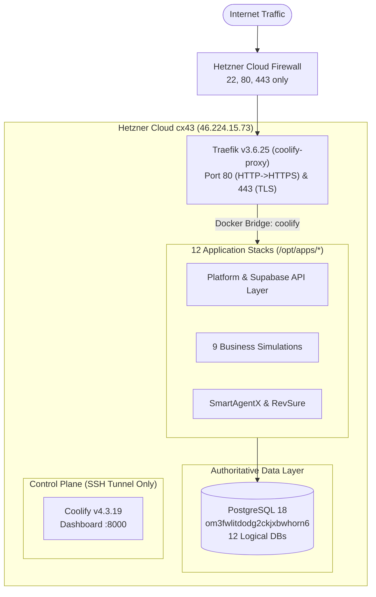

# Production Infrastructure

> **CANONICAL REPOSITORY ENTRY POINT**  
> For the complete, live-verified operational specification and architecture, see:  
> 📖 **[`INFRASTRUCTURE_SOURCE_OF_TRUTH_2026-09-14.md`](INFRASTRUCTURE_SOURCE_OF_TRUTH_2026-09-14.md)**

---

## 1. Overview

This repository contains the infrastructure code, deployment automation, database schema baselines, and operational documentation for the production hosting environment supporting:

1. **StratagemEngine** — B2B simulation training platform (`platform.stratagemengine.com`) and its 9 independent business simulations on subdomains of `stratagemengine.com`.
2. **SmartAgentX.ai** — AI marketing site and product portfolio (`smartagentx.ai`, `revsure.smartagentx.ai`, `merchantsignal.smartagentx.ai`) collocated on the same host for infrastructure economy.

The entire environment runs on a single **Hetzner Cloud VM** in Falkenstein, Germany:
- **Server Name:** `coolify-server` (ID: `163952663`)
- **Server Type:** `cx43` (8 vCPU AMD, 16 GB RAM, 160 GB NVMe)
- **Public IPv4:** `46.224.15.73`
- **Public IPv6:** `2a01:4f8:c014:6336::1`
- **OS:** Ubuntu 24.04.4 LTS, Linux 6.8.0-137-generic
- **Firewall:** Hetzner Cloud Firewall `coolify-server-fw` + host `ufw` (Inbound: 22/SSH, 80/HTTP, 443/HTTPS only; all other inbound ports blocked)

---

## 2. Architecture & Ownership Split



### What Terraform Manages (Base IaC)
Terraform owns the foundational cloud layer only:
- `hcloud_server.coolify` (Hetzner VM)
- `hcloud_firewall.coolify_fw` (Cloud Firewall)
- `hcloud_ssh_key.generated` (Uploaded SSH Key)
- `null_resource.ssh_key` + `data.local_file.public_key` (Local key generation)

Run `terraform plan` at any time to verify base infrastructure state. It carries `lifecycle { prevent_destroy = true }` to protect production against accidental deletion.

### What Deploy Tooling & Docker Compose Manage (Application Layer)
All application containers, Traefik edge routing, database instances, and environment configurations live above the OS and are managed via:
- Git checkouts under `/opt/apps/<App>`
- Per-application Docker Compose files
- The push-to-deploy pipeline in [`deploy/`](deploy/) driven by JSON manifests

---

## 3. Quick Operator Runbook

### Connect to Production
```bash
# Direct SSH connection as root
ssh -i ./ssh/production-infra-key root@46.224.15.73

# Access Coolify Dashboard (bound to localhost:8000 on host; tunneled securely)
ssh -i ./ssh/production-infra-key -L 8000:localhost:8000 root@46.224.15.73
# Then open http://localhost:8000 in your browser
```

### Deploying Applications
Deploys are serialized and automated via `/opt/apps/deploy.sh`:
```bash
# Dry-run validation (checks git fetch, manifest, and compose config without building)
ssh -i ./ssh/production-infra-key root@46.224.15.73 "/opt/apps/deploy.sh <App> --check"

# Execute a zero-downtime deployment
ssh -i ./ssh/production-infra-key root@46.224.15.73 "/opt/apps/deploy.sh <App>"

# View recent deployment history
ssh -i ./ssh/production-infra-key root@46.224.15.73 "tail -n 20 /opt/apps/.deploy-history.log"
```

### Health Check Sweep
```bash
# Run from your local machine
$domains = @(
    "platform.stratagemengine.com", "leadership.stratagemengine.com",
    "autorevive.stratagemengine.com", "aitransformer.stratagemengine.com",
    "fmcg.stratagemengine.com", "macrolab.stratagemengine.com",
    "zerotopmf.stratagemengine.com", "professorstudio.stratagemengine.com",
    "venture-fund.stratagemengine.com", "smartagentx.ai",
    "revsure.smartagentx.ai", "stratagemengine.com", "www.stratagemengine.com"
)
foreach ($d in $domains) { curl.exe -sk -o NUL -w "$d -> %{http_code}`n" "https://$d" }
```

### Database Backups
- **Nightly automated cron:** `30 2 * * * /opt/backups/run-backup.sh` (runs at 02:30 UTC).
- **Manual on-demand dump:**
  ```bash
  ssh -i ./ssh/production-infra-key root@46.224.15.73 "/opt/backups/run-backup.sh"
  ```
- Dumps are stored locally in `/opt/backups/dumps/<timestamp>/` with 14-day retention.

---

## 4. Repository Structure & Document Hierarchy

### Repository Directory Map
```
.
├── README.md                                  # You are here: Canonical entry point & repository navigation
├── INFRASTRUCTURE_SOURCE_OF_TRUTH_2026-09-14.md # CANONICAL: Complete production state, runbooks & audit
│
├── main.tf                                    # Base IaC: Hetzner server, firewall, SSH key
├── variables.tf                               # Terraform variable definitions
├── outputs.tf                                 # Terraform outputs (IPs, connection commands)
├── providers.tf                               # Hetzner Cloud and HashiCorp provider constraints
├── terraform.tfvars                           # Sensitive/local variables (hcloud_token)
│
├── deploy/                                    # Deployment tooling & automation
│   ├── deploy.sh                              # Universal deploy script with input validation & rollback
│   ├── bootstrap.sh                           # Host setup script for CI/CD deploy user
│   ├── manifests/                             # Per-application deployment manifests (*.json)
│   ├── backups/                               # Nightly backup script (run-backup.sh)
│   ├── github/                                # Reusable GitHub Actions workflows
│   └── app-files/                             # Reference compose and proxy configs for onboarded apps
│
├── supabase/                                  # Database migrations & schemas
│   └── migrations/
│       └── 001_stratagem_platform_consolidated.sql # Consolidated platform database schema baseline
│
├── templates/
│   └── cloud-init.sh.tpl                      # Cloud-init template for server provisioning
│
└── [Historical Documentation]                 # Superseded baselines & point-in-time planning docs (see below)
```

### Document Status Classification

| Document | Classification | Purpose / Notes |
|---|---|---|
| **[`README.md`](README.md)** | **Canonical** | Root navigation, overview, and quick operator commands. |
| **[`INFRASTRUCTURE_SOURCE_OF_TRUTH_2026-09-14.md`](INFRASTRUCTURE_SOURCE_OF_TRUTH_2026-09-14.md)** | **Canonical** | The single comprehensive source of truth for the live production environment. |
| [`10-SEPT-2026-PRODUCTION-DEPLOYMENT.md`](10-SEPT-2026-PRODUCTION-DEPLOYMENT.md) | **Superseded** | Historical baseline document detailing the initial Hetzner migration (accurate through 2026-09-12). |
| [`DEPLOYMENT.md`](DEPLOYMENT.md) | **Historical** | Reference guide for the retired DigitalOcean droplet environment. |
| [`ADMIN_GUIDE.md`](ADMIN_GUIDE.md) | **Historical** | Operator playbook for the retired DigitalOcean droplet environment. |
| [`INFRASTRUCTURE_GAP_ANALYSIS.md`](INFRASTRUCTURE_GAP_ANALYSIS.md) | **Superseded Planning** | Point-in-time assessment (2026-09-11) for SmartAgentX collocation. Decision executed. |
| [`MIGRATION_PLAN.md`](MIGRATION_PLAN.md) | **Superseded Planning** | Point-in-time migration plan (2026-09-11) for SmartAgentX deployment. Decision executed. |
| [`PRODUCTION_INFRASTRUCTURE_ASSESSMENT.md`](PRODUCTION_INFRASTRUCTURE_ASSESSMENT.md) | **Superseded Planning** | Point-in-time capacity assessment (2026-09-11). Decision executed. |
| [`PRODUCTION_MIGRATION_RISKS.md`](PRODUCTION_MIGRATION_RISKS.md) | **Superseded Planning** | Point-in-time risk register (2026-09-11). Decision executed. |
| [`SECOND_APPLICATION_REQUIREMENTS.md`](SECOND_APPLICATION_REQUIREMENTS.md) | **Superseded Planning** | Point-in-time specification (2026-09-11) for SmartAgentX. Decision executed. |
| [`TARGET_PRODUCTION_ARCHITECTURE.md`](TARGET_PRODUCTION_ARCHITECTURE.md) | **Superseded Planning** | Point-in-time architecture proposal (2026-09-11). Collocation live. |
| [`TERRAFORM_CHANGE_PLAN.md`](TERRAFORM_CHANGE_PLAN.md) | **Superseded Planning** | Point-in-time IaC impact assessment (2026-09-11). Confirmed no base IaC changes required. |
